# Architecture Overview

## Architectural Intent

The SAS Modernization Factory is a control-plane-driven migration system that converts SAS workloads into governed Databricks implementations.

The design intentionally separates:

- orchestration from execution
- deterministic transformation from AI reasoning
- conversion from validation
- generic factory capabilities from deployment-specific policy
- automated processing from human exception handling

## Current competition architecture

Status legend: **P** = proven locally with real bytes/runtime; **E** = implemented foundation whose
customer/live proof is pending; **M** = modernization foundation for later phases; **N** = planned
Day 1 integration. Arrows show the intended left-to-right evidence flow, not an assertion that one
operator command executes the whole path today.

```mermaid
flowchart LR
    D["P/E Discovery<br/>SMF filesystem and SAS Content Assessment"] --> L["E LIBNAME/path resolution<br/>BASE-06"]
    L --> R["P SAS7BDAT readers<br/>pyreadstat 1.3.6 + ReadStat<br/>spark-sas7bdat + Parso"]
    R --> C["P/E Canonical descriptors<br/>BASE-04"]
    C --> T["E Semantic/type mapping<br/>BASE-02"]
    D --> S["P Deterministic SAS code conversion<br/>sas2databricks 0.4.0 / CV-04"]
    S -->|non-success only| A["E Bounded AI repair<br/>AIREP-01 via Humana AI Gateway contract<br/>no live transport"]
    T --> X["P/E Spark and Delta<br/>PySpark 3.5.8, Arrow 25.0.1, delta-rs 1.6.4"]
    S --> X
    A --> X
    X --> U["E Unity Catalog planning<br/>DBPKG-01; live UC pending"]
    X --> V["P/N Validation<br/>DataComPy 1.0.4 + DP-02..05 + VAL-01"]
    V --> E["E/N Immutable evidence and readiness<br/>PROV-01/02, DBX-04, READY-02"]
    E --> Q["E/N Exceptions and human decisions<br/>FAIL-01, TASK-24, REM-03"]
    Q --> F["M Feedback and recommendations"]
    F --> Z["M Later estate modernization<br/>BASE-09, MODAP-01, MODCLI-01"]
```

The proven local vertical slice is `.sas7bdat -> pyreadstat -> Spark DataFrame -> local Delta ->
DataComPy reconciliation -> immutable evidence`. The partitioned reader proof uses
`spark-sas7bdat`/Parso without collecting the complete table locally. Live Humana AI Gateway,
Databricks, Unity Catalog, SAS-runtime baselines, customer semantics, and production operations are
external-proof-pending and must remain fail closed.

## Logical Components

### Intake

Creates a canonical workload record and gathers source artifacts, metadata, dependencies, ownership, schedules, inputs, outputs, and business criticality.

### Assessment

Parses SAS, identifies constructs, analyzes dependencies, estimates complexity, detects unsupported behavior, and recommends a conversion route.

### Intermediate Representation

Normalizes source-language behavior into a stable representation that can be consumed by multiple target emitters and validation components.

### Conversion

Applies deterministic rules first. Unsupported or ambiguous constructs may be routed to AI-assisted transformation subject to policy.

### Validation

Validates compilation, execution, structural parity, data parity, semantic parity, and performance as required by workload policy.

### Remediation

Analyzes failures and attempts bounded remediation. Exhausted retries or high-risk failures are routed to a human engineer.

### Promotion

Packages and promotes validated artifacts through controlled deployment pipelines.

### Provenance

Records how every target artifact was produced and what evidence supports its acceptance.

## Deployment Model

The expected enterprise deployment uses Azure for the factory control plane and Databricks for execution and target workload hosting.

The architecture remains modular enough to support alternate implementations where required.

## Security threat model

The versioned [competition critical-loop threat model](threat-model.md) documents data flows,
trust boundaries, threats, controls, evidence requirements, and unresolved operation-specific
blockers. It is an offline architecture/control contract, not proof of operational AI transport,
Humana runtime enforcement, parity, certification, or promotion.
