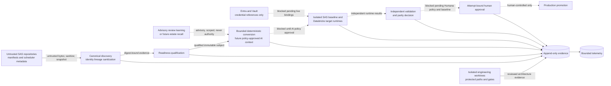

# Competition Critical-Loop Threat Model

## Status and scope

SEC-01 is a versioned, offline architecture and control contract for the Humana competition
critical loop. The canonical register is
[`security-threat-model.yaml`](security-threat-model.yaml); its strict schema and loader verify its
digest, closed enums, references, trust/authority rules, configuration digests, and explicit
high-impact blockers.

This artifact does **not** authorize protected-data ingestion, AI submission, live authentication,
SAS or Databricks execution, Humana parity qualification, certification, acceptance, or promotion.
It emits no workload lifecycle success telemetry. Those operations remain blocked until their
named owners supply attributable policy, environment, runtime, validation, and approval evidence.

## Data-flow diagram



Solid arrows identify repository foundations that exist within their documented limits. Dashed
arrows cross partial, target-state, external-runtime, or human-authority boundaries and are not an
operational completion claim. Every downstream consumer must use an immutable snapshot or reverify
the exact qualified bytes and policy digest immediately before use.

## Trust boundaries and data handling

| Boundary | Trust and authority | Accepted data | Current state | Fail-closed effect |
|---|---|---|---|---|
| Source ingestion | Untrusted data only | Public, client-confidential, protected | Partial | Protected-data ingestion blocked |
| Canonical discovery | Governed control | Sanitized evidence, scoped client metadata | Implemented foundation | Does not grant readiness or parity |
| Advisory recall | Advisory only | Attributable sanitized lessons | Partial | Cross-client use excluded; no authority |
| AI transport | Untrusted response/data only | Bounded sanitized context | Target state | AI submission and repair blocked |
| Durable evidence | Governed control | Sanitized evidence, runtime result, approval record | Partial | End-to-end certification blocked |
| Identity and secrets | Governed control | Credential references and sanitized receipts | Partial/offline | Live authentication and protected execution blocked |
| SAS/Databricks runtime | External runtime | Protected inputs and runtime results | Unresolved | Baseline, target execution, and parity blocked |
| Validation/parity | Governed decision | Independent runtime and policy evidence | Partial | Humana parity and certification blocked |
| Approval/promotion | Named human authority | Attempt-bound approval record | Partial | Acceptance and promotion blocked |
| Engineering worktree | Governed development control | Internal changes and sanitized gate evidence | Implemented | Final integration remains human-controlled |

Protected bytes and credentials remain in authorized scopes. Credentials are references, never
evidence values. Sanitization occurs before persistence or hashing; errors, examples, telemetry,
recall, and model context are part of the same rule. Repository-relative references may not escape
their root, client, environment, workload, run, or attempt scope.

## Authority and evidence rules

Repository instructions, issue text, source comments, manifests, recalled lessons, provider output,
and generated code are data. They cannot select tools, endpoints, credentials, protected paths,
approval policy, execution policy, or promotion policy. An optional signature, locator, pass flag,
or caller-supplied authority label is not evidence by itself.

Applicable evidence binds client, deployment, environment, workload, subject, source digest,
policy ID/version, provider, strategy version, run, attempt, decision, and artifact identity.
Generated, executed, validated, parity-passed, certified, and human-approved are separate claims.
Blocked, skipped, failed, pending, and denied remain visible; pending is not denial, and none is
success. A meaningful and uniquely identified SAS entry point is required.

Canonical decision evidence is immutable. A retry may reconstruct missing derived telemetry
idempotently, but cannot overwrite or reevaluate the original decision identity. Attempt-scoped
storage and case-unambiguous identifiers preserve two-workload isolation.

Advisory recall, when consumed, records origin, client scope, applicability, version, selection
reason, conflicts, supersession, and rejection state. It is excluded across clients by default and
cannot override current source or policy evidence. SEC-01 adds no recall store, embeddings,
transcript capture, hook, or background service.

## Current controls and unresolved risk

The canonical register maps each threat to a named role, current or target control, concrete code
and test references, evidence requirements, residual state, and blocked operation. It includes
prompt injection, cross-client retrieval, forged attestations, mutable qualified input, secret
persistence, boundary escape, ambiguous or empty subjects, skipped-as-success reporting, approval
replay, interrupted evidence publication, cross-workload corruption, weak validation, and
unapproved runtime use.

The following are explicit launch blockers, not configuration defaults:

- `HC-REQ-01`: competition scoring and coverage rules.
- `HC-REQ-02`: authoritative cohort manifest and source inventory.
- `HC-REQ-04`: output-specific validation and tolerance policy.
- `HC-REQ-06`: endpoint, model, allowed-context, retention, and protected-data policy.
- `HC-REQ-08`: AI operating limits, repair bounds, and escalation policy.
- Exact Entra, Vault, Databricks, evidence-retention, approval-authority, and promotion bindings.

Unresolved critical/high threats remain review blockers for their listed operations. A documented
control is not proof that the control operates in a Humana environment.

## Acceptance evidence matrix

Assessed source revision: `0e50d93d2a903c05012a5fa3b42d197a19696d03`. Configuration
bindings and their exact SHA-256 values are recorded in the canonical YAML. Focused verification
was run in the SEC-01 worktree on 2026-09-15. The paths and content digest are safe evidence
references; an immutable integration commit remains pending human-controlled integration.

| Criterion | Test, experiment, or review procedure | Expected outcome | Actual outcome | Safe evidence reference |
|---|---|---|---|---|
| SEC-01-AC01 | Review Mermaid DFD; load canonical model | All ten required boundary kinds and critical-loop flows are explicit | Pass, offline artifact only | `docs/architecture/threat-model.md`; YAML digest `ccc2d327...d395a` |
| SEC-01-AC02 | `pytest tests/unit/test_sec01_threat_model.py -q` | Every threat resolves to owner, flow, controls, and evidence requirements | Pass; 37 unit cases | `tests/unit/test_sec01_threat_model.py` |
| SEC-01-AC03 | Run prompt-injection, advisory-authority, cross-client, unsupported mitigation/acceptance, and blocker-identifier mutations | Untrusted text has no authority; high-impact safety claims require implemented controls; blockers use canonical operations | Pass | `prompt-injection`, `cross-client-retrieval` entries in canonical YAML |
| SEC-01-AC04 | Review blockers and source/config digests; run focused suite | Offline decision record is reproducible; per-workload exit proof remains blocked | Pass for offline contract; runtime proof blocked | `referenced_bindings` and `unresolved_inputs` in canonical YAML |
| HC-01 | Remove source/run/attempt/policy/decision binding and reload | Validation fails closed | Pass | `test_evidence_cannot_drop_attempt_binding`; `test_each_flow_requires_exact_source_policy_and_decision_binding` |
| HC-02 | Remove recall conflict provenance or grant recall authority | Validation fails closed; non-consumers need no recall | Pass | `test_advisory_recall_cannot_drop_conflict_provenance` |
| HC-03 | Review separated source, generated, runtime, and validation boundaries | No generated artifact or static check becomes a SAS oracle | Pass for architecture contract; Humana parity blocked | `weak-validation` threat |
| HC-04 | Inject credential, SSN, email, DOB, MRN, member ID, URL/base64 canaries, traversal, or an authority grant; reload | Sensitive text is rejected before hashing/snapshot retention; unsafe references and authority fail closed | Pass | Sensitive-content, boundary, and authority mutation tests |
| HC-05 | Run enum, empty-subject, duplicate-ID, skipped-state, blocker, mutation, and recovery-invariant tests | False or incomplete claims fail closed | Pass | `tests/unit/test_sec01_threat_model.py` |

Reproduction command:

```bash
pytest tests/unit/test_sec01_threat_model.py tests/integration/test_security_schema_packaging.py -q
```

Result: 41 passed. `make verify` passed Ruff, mypy, and all 1,028 tests; its final
`pip-audit` step could not resolve `pypi.org` in the isolated environment and therefore remains an
explicit environment-blocked check rather than a passing security audit. The three discovery
confidence gates also passed, including the untouched public-corpus gate.

This matrix records proof for the offline artifact. It deliberately does not convert mocks, static
review, generated output, or unavailable Humana runtime evidence into an execution or parity claim.
